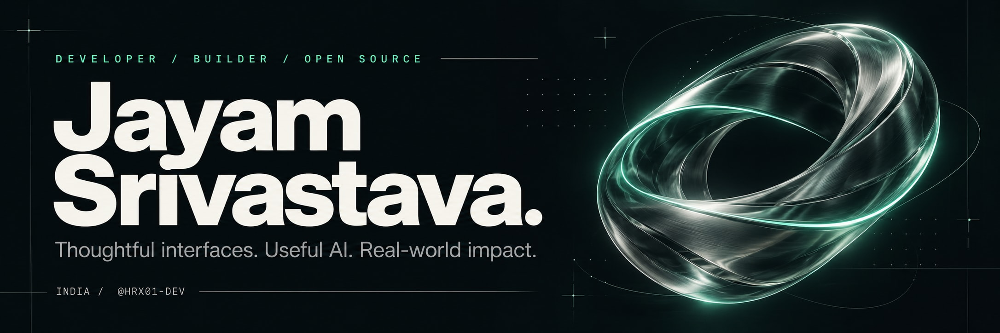
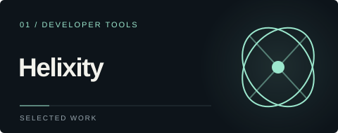
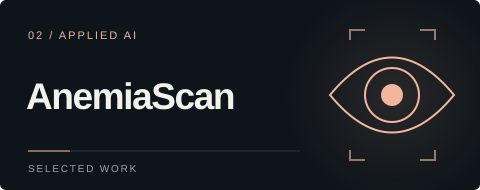
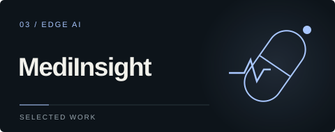
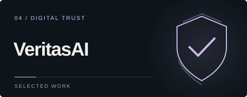
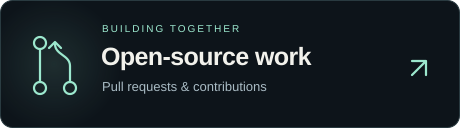
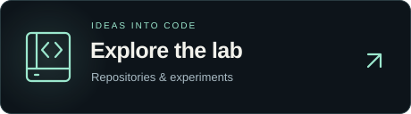

  
    
  <a href="https://www.linkedin.com/in/jayam-srivastava-519aa8377">LinkedIn ↗</a> &nbsp; · &nbsp;
  <a href="mailto:jayamsrivastava99@gmail.com">Email ↗</a> &nbsp; · &nbsp;
  <a href="https://github.com/hrx01-dev?tab=repositories">Explore my work ↗</a>
    
  

 

### 01 / A little about the builder

I'm **Jayam**, a developer from **India** working across full-stack applications, applied AI, and open source. I like taking an idea all the way from its first interface to the APIs and systems behind it.

Right now, I'm building **Helixity** to help teams keep up with API changes, exploring useful AI through healthcare projects, and creating web experiences through **Servio**. Hackathons are where I test ideas quickly; open source is where I learn to make them better.

**I care about:** interfaces that feel considered, software that solves a real problem, and learning by shipping.

 

### 02 / Selected work

<table>
  <tr>
    <td width="50%" valign="top">
      
        
      <b>Keeping integrations in step with change.</b>
      
Building a platform to detect API changes, find affected code, and prepare migration pull requests for review.

      
TypeScript · Next.js · API automation

      <a href="https://github.com/Helixity-io"><b>Explore the organization ↗</b></a>
        
    </td>
    <td width="50%" valign="top">
      
        
      <b>A different lens on anemia screening.</b>
      
A HackIndia project exploring image-based anemia screening, with a React interface, FastAPI backend, and model ensemble. A research screening aid.

      
React · Python · FastAPI · Machine learning

      <a href="https://github.com/hrx01-dev/hackindia-ai-web3-builders-hackathon-2026-zero-bug-theory"><b>Explore the repository ↗</b></a>
        
    </td>
  </tr>
  <tr>
    <td width="50%" valign="top">
      
        
      <b>More independence for older adults.</b>
      
An Android medicine assistant combining OCR and on-device language models to make medicine information easier to understand.

      
Android · Kotlin · OCR · On-device AI

      <a href="https://github.com/hrx01-dev/MediInsight"><b>Explore the repository ↗</b></a>
        
    </td>
    <td width="50%" valign="top">
      
        
      <b>Tools for a more trustworthy internet.</b>
      
A multimodal analysis dashboard bringing together text, URL, image, and video checks with a React frontend and FastAPI backend.

      
React · FastAPI · PyTorch · Firebase

      <a href="https://github.com/hrx01-dev/VeritasAI"><b>Explore the repository ↗</b></a>
        
    </td>
  </tr>
</table>

 

### 03 / My toolkit

<h4>Interfaces</h4>

   &nbsp;
   &nbsp;
   &nbsp;
   &nbsp;
   &nbsp;
  

<h4>Languages &amp; APIs</h4>

   &nbsp;
   &nbsp;
   &nbsp;
   &nbsp;
   &nbsp;
  

<h4>Data &amp; infrastructure</h4>

   &nbsp;
   &nbsp;
   &nbsp;
   &nbsp;
  

<h4>AI &amp; developer workflow</h4>

   &nbsp;
   &nbsp;
   &nbsp;
   &nbsp;
   &nbsp;
  

 

### 04 / Built with the community

Open source is part of how I build, not just something I do on the side. Through **GSSoC** and community projects, I've worked on UI components, security improvements, testing, and developer experience.

I enjoy the whole process: understanding an issue, discussing a direction, making the change, and refining it through review.

  
  &nbsp;
  

 

---

   
  <b>Have something useful in mind? Let's build it.</b>
  
Open-source ideas, thoughtful products, and good technical conversations.

  <a href="mailto:jayamsrivastava99@gmail.com">Say hello ↗</a> &nbsp; · &nbsp;
  <a href="https://www.linkedin.com/in/jayam-srivastava-519aa8377">Connect on LinkedIn ↗</a>
    
  Always curious. Always building.

